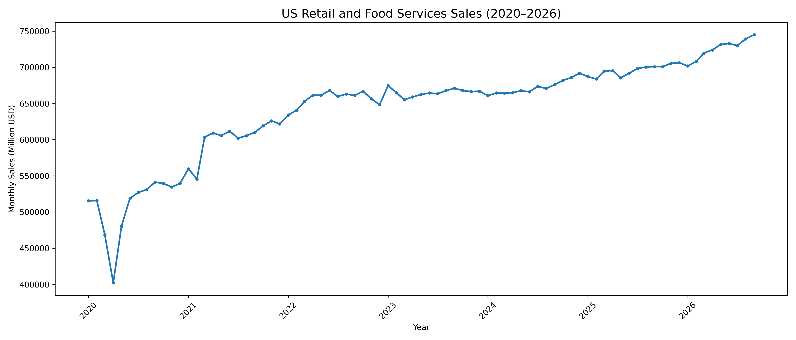
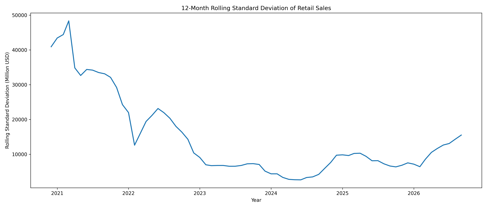
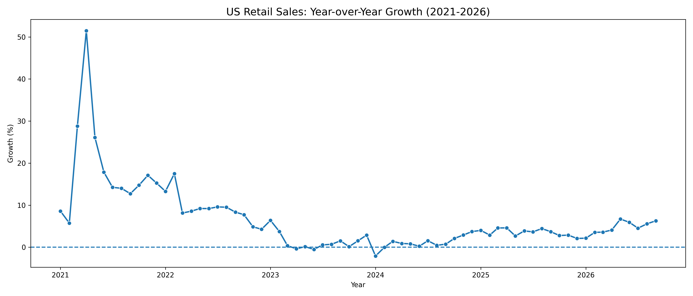

 U.S. Retail and Food Services Sales Analysis (2020–2026)

 Project Overview
This project focuses on analysing monthly U.S. retail and food services sales data from January 2020 to September 2026 using Python. The primary objective is to examine historical sales trends, identify growth patterns, evaluate changes in sales performance, and understand how retail sales evolved across different periods.
The project applies data cleaning, exploratory data analysis (EDA), descriptive statistics, percentage growth calculations, and data visualisation to transform raw monthly sales data into meaningful analytical insights.
The analysis covers a period characterised by significant economic disruptions, post-pandemic changes, and subsequent shifts in retail sales performance. Particular attention is given to the changes observed during 2020, the subsequent recovery period, and the more recent sales trends.
Rather than relying solely on overall sales figures, the project examines monthly and annual performance, month-over-month (MoM) growth, year-over-year (YoY) growth, and comparisons across selected periods.

 Project Objectives
The main objectives are:
- Analyse the overall trend in U.S. retail and food services sales between 2020 and 2026.
- Clean and transform the original dataset into a structured format suitable for analysis.
- Validate the dataset by identifying missing values, duplicate records, invalid observations, and chronological inconsistencies.
- Calculate descriptive statistical measures to understand the distribution and variation of sales.
- Examine annual sales performance and changes in average sales over time.
- Calculate month-over-month and year-over-year sales growth.
- Compare sales performance across different periods.
- Identify the highest and lowest recorded monthly sales values.
- Develop visualisations to communicate important trends and analytical findings.

 Tools and Technologies
- Python – Primary programming language.
- Pandas – Data cleaning, transformation, aggregation, and analysis.
- NumPy – Numerical operations.
- Matplotlib/Seaborn – Data visualisation.
- Microsoft Excel – Initial dataset inspection and handling.
- PyCharm – Python development environment.

 Analytical Methodology
The project follows a structured analytical workflow:
1. Data Acquisition: Obtaining the original monthly retail and food services sales dataset.
2. Data Cleaning: Extracting the relevant data, restructuring it into a tabular format, converting dates, and handling unavailable observations.
3. Data Validation: Checking missing values, duplicate dates, invalid sales values, chronological ordering, and missing monthly periods.
4. Exploratory Data Analysis: Examining sales distributions, historical trends, and variations over time.
5. Statistical Analysis: Calculating mean, median, variance, standard deviation, range, and coefficient of variation.
6. Growth Analysis: Measuring month-over-month and year-over-year percentage changes.
7. Comparative Analysis: Evaluating annual performance and comparing corresponding January–September periods.
8. Data Visualisation: Presenting the results through charts and graphical representations.

Key Findings
The analysis produced several notable observations:
- The dataset contains 81 monthly observations covering January 2020 to September 2026.
- April 2020 recorded the lowest monthly sales value in the analysed period.
- September 2026 recorded the highest observed monthly sales value.
- Annual average sales increased substantially between 2020 and 2022, followed by slower growth during 2023 and 2024.
- Sales growth strengthened in 2025 compared with the preceding two years.
- September 2026 recorded year-over-year growth of approximately 6.29%.
- Total sales for January–September 2026 were approximately 4.71% higher than the corresponding period in 2025.
- The average month-over-month sales change across the analysed observations was approximately 0.52%.

These findings are descriptive and indicate observed changes in reported sales. They do not establish causal relationships between economic events and sales performance.

Project Scope and Limitations
This project focuses on descriptive and exploratory analysis rather than causal inference or advanced predictive modelling.

The analysis has several limitations:
- The dataset covers only the selected period and available observations.
- The 2026 data represents January–September and therefore does not constitute a complete calendar year.
- Nominal sales figures do not independently account for inflation.
- The interpretation of month-to-month movements depends on whether the original series is seasonally adjusted.
- The analysis does not incorporate external explanatory variables such as inflation, unemployment, consumer confidence, or interest rates.

Visualisations

The following charts illustrate the trends and patterns identified in the analysis.

1. Monthly Retail Sales Trend

2. Annual Average Retail Sales

3. Retail Sales Volatility

4. Year-over-Year Growth Analysis

Project Structure

- `data/` – Original and cleaned datasets.
- `visualisations/` – Generated analytical charts.
- `Retail_Sales_Analysis.py` – Python analysis script.
- `requirements.txt` – Required Python packages.
- `README.md` – Project documentation.
